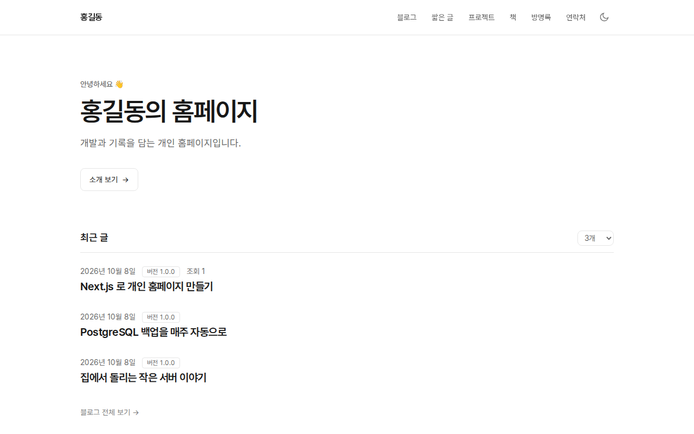
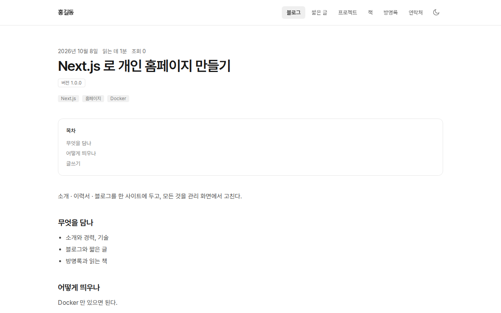
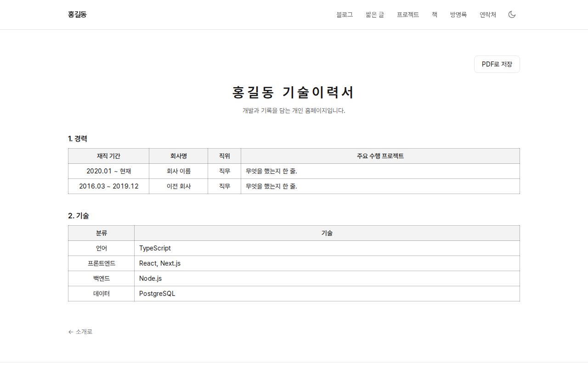
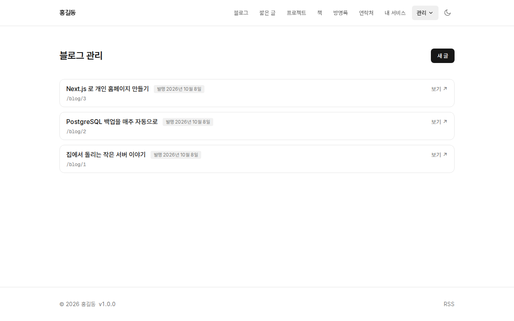

# myhome

> Self-hosted personal homepage — about · résumé · blog · guestbook · reading list,
> plus a private space (diary · notes · to-dos · Google Calendar).
> Next.js + PostgreSQL, one-line Docker install. The UI is in Korean.

1인용 개인 홈페이지. 소개 · 이력서 · 블로그 · 짧은 글 · 방명록 · 읽는 책을
한 사이트에서 제공하고, 본인만 보는 「내 공간」(일기장 · 메모 · 할 일 · 일정)까지 모두
웹 관리 화면에서 관리한다. 앱 하나와 PostgreSQL 하나로 동작한다.

- **소개 · 이력서**: 경력 · 기술 · 수행 업무. 이력서는 기술이력서 표 형식으로
  표시하고 브라우저 인쇄 기능으로 PDF 로 저장한다. 인적 사항처럼 공개하고 싶지 않은 항목은
  본인에게만 보이도록 선택한다
- **글**: 블로그(목차 · 태그 · 검색 · 연재 · 관련 글 · 예약 발행 · 개정 표시),
  짧은 글, 비공개 비밀글(서버에서 암호화해 저장). 마크다운 기반이며 위지윅 편집기 3종
  가운데 선택한다. 이미지는 붙여넣기 · 끌어다 놓기로 업로드한다
- **책**: 읽는 중 · 읽고 싶은 책 · 다 읽음 · 읽다 만 책, 분류, 책별 독서 노트와
  별점. 제목 · ISBN 으로 검색해 정보를 채운다 — 카카오 · 내 Calibre 서재 · Open Library 에서
  검색하고(순서와 사용 여부는 선택한다), 선택한 책의 소개는 AI(Gemini)가 한두 줄로 요약한다
- **소통**: 댓글 · 방명록(「나에게만 보내기」 로 연락도 가능). 텔레그램으로
  알림을 받을 수 있다
- **내 공간**(본인 전용, 암호화해 저장): 하루 한 편 일기장, 메모, 할 일, 구글
  캘린더 일정(월간 · 주간). 텔레그램 봇에게 「메모 …」 · 「할일 …」 로 보내도
  등록되고(「내일 우유 사기」 처럼 접두어 없이 보내도 할 일로 등록되며, AI 판정도 선택할 수 있다),
  어느 화면에서나 ＋ 버튼으로 바로 기록한다
- **관리**: 로그인하면 대시보드(새 메시지 · 오늘 할 일 · 일정 · 임시저장 글)를 표시한다.
  메뉴 · 사이트 정보 · 코드(분류) · 환경설정(외부 서비스 연동)을 화면에서 수정한다.
  패스키 로그인
- **외부 연동**: 사이트맵 · RSS · 링크 미리보기 이미지 · 검색엔진 등록

한국어로 작성된 사이트다. 화면 문구와 날짜는 한국어 · 한국 시간 기준이다.

| 홈 화면 | 글 |
| --- | --- |
|  |  |
| **이력서** | **관리 화면** |
|  |  |

실제 운영 중인 예: [leechis.dev](https://leechis.dev)

## 5분 안에 설치하기

Docker 와 `docker compose`(v2) 만 있으면 된다. 우분투의 경우:

```bash
curl -fsSL https://raw.githubusercontent.com/leechis7/myhome-public/main/install.sh | bash
```

설치 폴더 · 포트 · 사이트 주소 · 비밀글 사용 여부 · 데이터 저장 위치를 묻고
([데이터 저장 위치](#데이터-저장-위치)), 나머지 비밀값은 자동으로 생성해 설정한다. 완료되면 다음과 같이 안내한다.

```
  주소     http://localhost:3000/admin
  설치 코드  7K2Q-9MXD
```

해당 주소를 열고 설치 코드와 새 관리자 비밀번호를 입력하면 로그인된다. 설치 코드는
다른 사람이 먼저 접속해 관리자가 되는 것을 막기 위한 것으로, 서버를 실행한 사람만 볼 수 있는
앱 로그에만 출력된다.

### 수동으로 설치하기

스크립트를 사용하지 않으려면 [compose.yaml](compose.yaml) 을 내려받아 같은 폴더에
`.env` 를 두 줄 작성한다.

```bash
mkdir myhome && cd myhome
curl -fsSLO https://raw.githubusercontent.com/leechis7/myhome-public/main/compose.yaml
cat > .env <<EOF
POSTGRES_PASSWORD=$(openssl rand -hex 24)
SESSION_SECRET=$(openssl rand -base64 32)
EOF
chmod 600 .env
docker compose up -d
docker compose logs app | grep "처음 설정 코드"
```

## 초기 설정

1. `/admin` 에서 관리자 비밀번호를 설정한다(위의 설치 코드)
2. **관리 › 설정 › 사이트**: 이름 · 제목 · 한 줄 소개 · 대표 메일. 비워 두면
   「홍길동」 같은 예시 값이 표시된다
3. **관리 › 설정 › 프로필**: 소개 글 · 연락 수단 · 경력 · 기술 · 수행 업무
4. **관리 › 설정 › 환경설정**: 기본 편집기, 텔레그램 알림 · 카카오 책 검색 ·
   Gemini 요약 · 통계 같은 외부 서비스(사용하는 것만)
5. **관리 › 설정 › 보안**: 패스키(얼굴 · 지문)를 등록해 두면 비밀번호 없이 로그인할 수 있다
6. **관리 › 설정 › 메뉴**: 상단 메뉴의 항목과 순서

## 도메인과 HTTPS

앱은 `http://…:3000` 으로만 서비스한다. 외부에 공개할 때는 앞단에 리버스 프록시를 두고,
`.env` 의 `SITE_URL` 을 외부 주소로 변경한다(캐노니컬 · 사이트맵 · 공유 카드에서
사용한다).

[Caddy](https://caddyserver.com/) 를 사용하면 인증서까지 자동으로 발급받는다.

```
example.com {
	# https 로만 오게 한다(앱은 http 라 이 머리글을 붙이지 않는다)
	header Strict-Transport-Security "max-age=63072000"
	# 바깥에서 오는 요청 크기를 자른다. 그림 · 첨부를 올리는 관리 화면은 뺀다
	@not_upload not path /admin/*
	request_body @not_upload {
		max_size 1MB
	}
	reverse_proxy 127.0.0.1:3000
}
```

보안 헤더(CSP · X-Frame-Options 등)는 앱이 직접 추가한다. 프록시가 없으면
요청 크기는 앱의 한도(이미지 업로드 때문에 100MB)까지 허용된다 — 외부에 공개할
때는 위와 같이 프록시에서 요청 크기를 제한할 것을 권장한다.

```bash
# .env
SITE_URL=https://example.com
```

`.env` 를 수정한 뒤에는 `docker compose up -d` 로 다시 실행한다.

## 새 버전으로 업그레이드

```bash
cd ~/myhome
docker compose pull
docker compose up -d
```

데이터베이스 마이그레이션은 앱보다 먼저 자동으로 실행된다. 변경 내용은
[CHANGELOG.md](CHANGELOG.md) 에 있다. 버전을 고정하려면 `.env` 에
`MYHOME_VERSION=1.0.0` 처럼 지정한다(비우면 `latest`).

v1.4.0 보다 이전 버전을 사용하고 있다면, **먼저 v1.4.0 으로 업그레이드한 다음** 최신 버전으로
업그레이드한다. `.env` 에 `MYHOME_VERSION=1.4.0` 을 지정하고 위와 같이 업그레이드한 뒤, 그 줄을 삭제하고 한 번
더 업그레이드하면 된다. 바로 업그레이드하면 앱이 중지되고 그 절차를 안내한다.

## 데이터 저장 위치

보존해야 할 데이터는 세 가지다: 데이터베이스(글 · 설정), 첨부파일(글에 삽입한 이미지 포함), 비밀글 첨부파일.
두 위치 중 한 곳에 저장한다. 설치할 때 install.sh 가 선택을 묻는다.

| | Docker 볼륨 (기본) | 설치 폴더의 `data/` |
| --- | --- | --- |
| 위치 | `/var/lib/docker/volumes/myhome-local_{db,uploads,secrets}` | `~/myhome/data/{db,uploads,secrets}` |
| 확인 | `docker volume ls` 로 확인한다. 폴더를 보려면 `sudo` | 설치 폴더 안에서 보인다 |
| 이전 · 백업 | 볼륨마다 `docker run … tar` 로 추출한다 | 중지한 뒤 설치 폴더 전체를 복사하면 된다 |
| 파일 소유자 | Docker 가 관리한다. 별도로 신경 쓸 필요가 없다 | 컨테이너 사용자(데이터베이스는 uid 70, 첨부파일은 uid 1000)이므로, 열거나 삭제할 때 `sudo` 가 필요할 수 있다 |
| 삭제 | `docker compose down -v` | `down` 한 뒤 `sudo rm -rf data` |

**볼륨이 기본인 이유.** 권한 문제가 없다. 컨테이너 안의 데이터베이스와 앱은 내 계정이
아닌 각각의 사용자로 실행되는데, 볼륨은 Docker 가 그 소유자를 자동으로 관리한다.
`docker compose down` 을 해도 유지되고, 실수로 설치 폴더를 삭제해도 글이 보존된다.
한 서버에서 장기간 운영할 계획이라면 이 방식이 편리하다.

**설치 폴더에 저장하는 이유.** 「myhome 의 모든 것은 이 폴더에 있다」 가 된다.
무엇이 어디에 얼마나 있는지 직접 확인할 수 있고, 다른 서버로 이전할 때 폴더 하나를
`rsync` 하면 되며, 서버 백업이 이미 홈 폴더를 포함하고 있다면 별도 작업이 필요 없다.
노트북에서 테스트 삼아 실행하거나 자주 이전할 계획이라면 이 방식이 편리하다.

어느 방식이든 앱은 동일하게 동작한다. 설치 폴더에 저장하기로 하면 install.sh 가
`compose.override.yaml` 을 생성한다. `compose.yaml` 은 변경되지 않으므로, 새로 내려받아도
이 설정은 유지된다.

```yaml
# compose.override.yaml - docker compose 가 compose.yaml 과 함께 저절로 읽는다
services:
  postgres:
    volumes:
      - ./data/db:/var/lib/postgresql
  app:
    volumes:
      - ./data/uploads:/app/storage/uploads
      - ./data/secrets:/app/storage/secrets
```

### 볼륨에 설치한 데이터를 설치 폴더로 이전하기

```bash
cd ~/myhome
docker compose down
mkdir -p data
for v in db uploads secrets; do        # 주인 · 권한 그대로 복사한다
  docker run --rm -v myhome-local_$v:/from -v "$PWD/data/$v":/to alpine cp -a /from/. /to/
done
# 위의 compose.override.yaml 을 만든다
docker compose up -d
# 글 · 첨부파일이 그대로인지 보고, 옛 볼륨을 지운다(선택)
docker volume rm myhome-local_db myhome-local_uploads myhome-local_secrets
```

반대 방향(폴더 → 볼륨)은 `compose.override.yaml` 을 삭제하고 같은 `cp -a` 를
방향만 바꿔 실행한다.

## 백업

글 · 설정은 데이터베이스에, 첨부파일은 파일로 저장되어 있다. 두 가지 모두 백업한다.

**Docker 볼륨(기본)을 사용하는 경우**

```bash
cd ~/myhome
docker compose exec -T postgres pg_dump -U myhome myhome | gzip > myhome-$(date +%F).sql.gz
docker run --rm -v myhome-local_uploads:/data -v "$PWD":/out alpine \
  tar czf /out/uploads-$(date +%F).tar.gz -C /data .
docker run --rm -v myhome-local_secrets:/data -v "$PWD":/out alpine \
  tar czf /out/secrets-$(date +%F).tar.gz -C /data .
```

**설치 폴더의 `data/` 를 사용하는 경우** 데이터베이스가 실행 중인 상태로 파일을 복사하면 손상될 수 있다.
`pg_dump` 로 덤프하거나, 잠시 중지한 뒤 폴더 전체를 백업한다.

```bash
cd ~/myhome
docker compose exec -T postgres pg_dump -U myhome myhome | gzip > myhome-$(date +%F).sql.gz
sudo tar czf uploads-$(date +%F).tar.gz -C data uploads secrets
# 또는: docker compose stop && sudo tar czf myhome-$(date +%F).tar.gz . && docker compose start
```

비밀글을 사용한다면 `.env` 의 `SECRETS_KEY` 를 **별도로** 보관한다. 이 키를 분실하면
백업이 있어도 비밀글을 복호화할 수 없다.

## 중지 · 삭제

```bash
cd ~/myhome
docker compose stop        # 잠깐 멈춘다. docker compose start 로 다시 띄운다
docker compose down        # 컨테이너를 지운다. 글 · 첨부파일(데이터)은 남는다
```

**전체 삭제.** 글 · 첨부파일 · 설정이 모두 삭제되며 복구할 수 없다. 보존할
데이터가 있으면 먼저 [백업](#백업)한다.

```bash
cd ~/myhome
docker compose down -v --rmi all   # 컨테이너 · Docker 볼륨 · 받은 이미지까지
cd ~ && sudo rm -rf ~/myhome       # .env · compose.yaml (설치 폴더에 둔 data/ 도)
```

- `sudo` 는 데이터를 설치 폴더의 `data/` 에 저장했을 때 필요하다. 그 안의
  파일 소유자가 컨테이너 사용자이므로 내 계정으로는 삭제되지 않는다. Docker 볼륨에
  저장했다면 `rm -rf ~/myhome` 으로 충분하다
- 남은 항목이 없는지 확인한다: `docker volume ls | grep myhome-local`,
  `docker ps -a | grep myhome-local`
- 도메인을 연결했다면 리버스 프록시(Caddy 등)의 설정도 삭제한다

## 설정(.env)

`compose.yaml` 이 읽는다. 필수 항목은 두 가지이며 나머지는 비워 두면 비활성화된다.

설정은 두 그룹으로 나뉜다. **1** 은 `.env` 에만 지정한다 — 데이터베이스 접속 및 암호화 · 복호화에 쓰는 키와 서버마다 다른
값이므로 화면에서 변경할 수 없다. **2** 는 관리 › 설정 › 환경설정 에서도 입력할 수 있다.
`.env` 에 값이 있으면 그 값이 우선하며(화면의 해당 입력란은 잠긴다), 비워 두고 화면에서
입력해도 된다(휴대폰에서도 가능). 환경설정 화면의 모든 항목이 여기에 있다.
화면에서 입력한 토큰 · 키는 `SECRETS_KEY` 로 암호화해 저장한다.

**1. `.env` 에만**

| 변수 | 설명 |
| --- | --- |
| `POSTGRES_PASSWORD` | **필수.** 데이터베이스 비밀번호. 최초 실행 후에는 변경하지 않는다 |
| `SESSION_SECRET` | **필수.** 로그인 쿠키를 암호화하는 키(32자 이상). `openssl rand -base64 32` |
| `SECRETS_KEY` | 비밀글 · 일기장 · 메모 · 할 일과 화면에서 입력한 토큰 · 키를 암호화하는 키(32바이트 base64). 비우면 해당 기능이 비활성화되고 메뉴에서 제외된다. **분실하면 복구할 수 없다** |
| `ADMIN_PASSWORD` | 초기 관리자 비밀번호. 비우면 최초 `/admin` 접속 시 설치 코드로 설정한다. 최초 로그인 이후에는 참조하지 않는다(관리 › 설정 › 보안 에서 변경한다) |
| `SITE_URL` | 외부에서 접속하는 주소. 기본값 `http://localhost:3000` |
| `PORT` | 서비스 포트. 기본값 `3000` |
| `MYHOME_VERSION` | 사용할 이미지 버전. 기본값 `latest` |
| `TELEGRAM_INBOX` | `off` 이면 이 서버에서는 텔레그램 메모 · 할 일을 수신하지 않는다(같은 봇을 사용하는 개발 서버 등). 봇 하나당 수신 서버는 하나뿐이다 |
| `GEMINI_MODEL` | 사용할 Gemini 모델 하나. 비우면 `gemini-flash-lite-latest`, 한도를 초과하면 `gemini-flash-latest` |
| `TZ` | 시간대. 기본값 `Asia/Seoul` |

**2. 관리 › 설정 › 환경설정 에서도** (화면의 항목 순서대로)

| 항목 | 변수 | 설명 |
| --- | --- | --- |
| 글쓰기 | `DEFAULT_EDITOR` | 기본 편집기: `milkdown` · `tiptap` · `toast` |
| 텔레그램 | `TELEGRAM_BOT_TOKEN` · `TELEGRAM_CHAT_ID` | 댓글 · 방명록 알림과 텔레그램을 통한 메모 · 할 일 기록 |
| 텔레그램 | `TELEGRAM_REMINDERS` | `on` 이면 할 일 · 구글 캘린더 일정을 미리 알린다. 날짜만 있는 항목은 그날 아침 8시, 시각이 있는 항목은 1시간 · 30분 전. 기본값 꺼짐 |
| 구글 | `GOOGLE_CALENDAR_ICAL` | 구글 캘린더 iCal 비공개 주소. `이름 https://…` 을 `;` 로 연결한다 |
| 검색 등록 | `GOOGLE_SITE_VERIFICATION` | 구글 Search Console 소유 확인. HTML 태그 방식의 content 값 |
| 검색 등록 | `NAVER_SITE_VERIFICATION` · `BING_SITE_VERIFICATION` | 네이버 서치어드바이저 · 빙 웹마스터 도구 소유 확인. HTML 태그 방식의 content 값 |
| 검색 등록 | `INDEXNOW_KEY` | 글을 공개하면 IndexNow 로 빙 · 네이버에 알린다. 8~128자 영숫자(`openssl rand -hex 16`). 앱이 `/<열쇠>.txt` 를 제공한다. https 주소에서만 전송한다. 비우면 알리지 않는다 |
| 책 찾기 | `BOOK_SOURCES` | 검색 출처의 순서 · 사용 여부. 앞쪽이 우선이며, 비활성화하려면 앞에 `-` (예: `kakao,-calibre,openlibrary`). 비우면 카카오 → 내 서재 → Open Library |
| 책 찾기 | `KAKAO_REST_API_KEY` | 카카오 책 검색([developers.kakao.com](https://developers.kakao.com) 앱의 REST API 키). 비우면 카카오는 건너뛴다 |
| 책 찾기 | `CALIBRE_URL` · `CALIBRE_USER` · `CALIBRE_PASSWORD` | 내 [Calibre](https://calibre-ebook.com) 콘텐츠 서버에서도 검색해 소개 · 표지 · ISBN 을 가져온다(원서 포함). 앱 전용 읽기 계정을 권장한다 |
| AI 사용 | `AI_ENGINES` | 사용할 AI 엔진의 순서 · 사용 여부. 앞쪽이 우선이며, 비활성화하려면 앞에 `-` (예: `openclaw,-gemini`). 비우면 오픈클로 → Gemini. 모두 실패하면 AI 없이 처리 |
| AI 사용 | `OPENCLAW_URL` · `OPENCLAW_TOKEN` · `OPENCLAW_AGENT` · `OPENCLAW_CHAT_AGENT` | [OpenClaw](https://openclaw.ai) 게이트웨이를 AI 엔진으로 사용. 게이트웨이의 OpenAI 호환 엔드포인트(`gateway.http.endpoints.chatCompletions`)를 활성화해 둔다. 토큰은 게이트웨이 전체 권한을 갖는 키이므로 요약 · 분류에는 도구를 비활성화한 전용 에이전트를 권장한다(비우면 `homepage`). 「+」 창의 AI 대화는 대화창 에이전트를 호출한다(비우면 `main`) |
| AI 사용 | `GEMINI_API_KEY` | 책 소개 요약과 할 일 · 메모 분류(텔레그램 · 할 일 화면의 날짜 · 시각 인식)에 사용한다. 해당 글이 Gemini 로 전송된다([aistudio.google.com](https://aistudio.google.com) 의 무료 API 키). 비우면 요약은 소개 앞부분을 잘라 사용하고, 분류는 규칙으로 처리 |
| AI 사용 | `DIARY_AI` | 비공개 글(메모 · 일기)을 AI 로 전송할지 여부. `on` 이면 일기 작성 화면의 「그날 메모로 초안」 이 그날 메모를 AI 엔진으로 전송한다. 비우면 꺼짐 |
| AI 사용 | `AI_ASSISTANT` | `on` 이면 AI 대화창이 남은 할 일 · 7일 일정을 AI 엔진에 전송해 참고하여 답하고, 할 일 · 메모를 추가할 버튼을 제안한다(누를 때만 추가한다). 기본값 꺼짐 |
| AI 사용 | `MEETING_AI` | `on` 이면 내 공간 › 회의 에서 녹음하며 30초 단위로 Gemini 로 받아쓴다. 참석자 음성이 Google 로 전송된다. 텍스트만 암호화해 저장한다. 기본값 꺼짐 |
| AI 사용 | `MEETING_WAKE_WORDS` | 회의 중 비서를 호출하는 말(쉼표로 여러 개, 예: `푸딩`). 호출하면 즉시 할 일 · 메모 카드를 표시한다. 비우면 `비서` |
| AI 프롬프트 | `PROOF_AI_PROMPT` | 맞춤법 · 문장 교정 프롬프트. `{종류}` · `{글}` 자리가 채워진다. 응답은 `{"edits":[{from,to,why}]}` 형식. 줄바꿈은 `\n`. 비우면 기본값 |
| AI 프롬프트 | `SPAM_AI_PROMPT` | 새 방명록 · 댓글 스팸 판정 프롬프트. `{자리}` · `{이름}` · `{글}` 자리가 채워진다. 줄바꿈은 `\n`. 비우면 기본값 |
| AI 프롬프트 | `BOOK_REVIEW_PROMPT` · `BOOK_CATEGORY_PROMPT` | 독서 노트 기반 한 줄 평(`{제목}` · `{지은이}` · `{별점}` · `{노트}`), 소개 기반 분류 제안(`{제목}` · `{지은이}` · `{분류}` · `{소개}`) 프롬프트. 줄바꿈은 `\n`. 비우면 기본값 |
| AI 프롬프트 | `DIARY_AI_PROMPT` | 일기 초안 프롬프트. `{날짜}` · `{메모}` 자리가 채워진다. 줄바꿈은 `\n`. 비우면 기본값 |
| AI 프롬프트 | `POST_AI_PROMPT` | 글 요약 · 태그 제안 프롬프트(블로그의 「AI 로 채우기」 · 짧은 글의 「태그 제안」). `{종류}` · `{제목}` · `{태그}` · `{글}` 자리가 채워진다. 줄바꿈은 `\n`. 비우면 기본값 |
| AI 프롬프트 | `TODO_AI_PROMPT` | 할 일 · 메모 판정 프롬프트(텔레그램 · 할 일 화면 · 떠 있는 창). `{오늘}` · `{지금}` · `{종류}` · `{글}` 자리가 채워진다. 줄바꿈은 `\n`. 비우면 기본값 |
| AI 프롬프트 | `BOOK_SUMMARY_PROMPT` | 책 소개 요약 프롬프트. `{제목}` · `{지은이}` · `{소개글}` 자리에 해당 책의 정보가 들어간다. 줄바꿈은 `\n`. 비우면 기본값 |
| 홈페이지 API | `MYHOME_API_TOKEN_SHA256` | 홈페이지 API(`/api/v1/todos` · `memos` · `events` · `drafts`) 토큰의 sha256. 일반적으로 화면에서 발급한다(한 번만 표시). 비우면 API 가 모두 차단된다 |
| 통계 · 감시 | `UMAMI_WEBSITE_ID` | [umami](https://umami.is/) 방문 통계. 비우면 추적 스크립트가 출력되지 않는다 |
| 통계 · 감시 | `MONITORING_DASHBOARD` | 관리 › 감시 화면에 삽입할 Grafana 대시보드 경로. 비우면 메뉴에서 제외된다 |

## AI 연동

AI 는 필수가 아니다. 없으면 책 소개는 앞부분을 잘라 저장하고, 할 일 · 메모는 규칙으로 분류한다.
연동하면 AI 가 다음 작업을 수행한다.

- 책 찾기로 선택한 책의 소개를 한두 줄로 요약
- 텔레그램 · 할 일 화면 · 떠 있는 「+」 창에서 입력한 글을 할 일 · 메모로 분류하고 날짜 · 시각을 인식
  (「내일 오후 7시~9시 운동」 → 운동 · 내일 19:00~21:00)
- 블로그 · 짧은 글 작성 화면의 「맞춤법 · 문장 보기」 — 수정할 부분을 원문 → 제안 형태로 나열하고 하나씩 수락한다
- 새 방명록 · 댓글을 AI 가 검토해 광고 · 욕설 · 스팸이면 숨기고 텔레그램으로 알린다(관리자는 즉시 「보이기」 가능). AI 가 없거나 실패하면 그대로 표시된다
- 독서 노트의 「노트로 한 줄 평」(책 목록의 소개 입력란), 책 추가 · 수정 화면의 「분류 제안」(기존 분류 중에서 선택한다)
- 일기 작성 화면의 「그날 메모로 초안」 — 메모 · 일기는 비공개 글이므로 환경설정에서 별도로 활성화해야 한다(기본값 꺼짐)
- 블로그 작성 화면의 「AI 로 채우기」(요약 · 태그), 짧은 글의 「태그 제안」 — 기존에 사용하던 태그를 우선 선택한다
- 떠 있는 「+」 창의 **🤖 AI** 탭에서 대화. 오픈클로는 평소 대화하는 에이전트(대화창 에이전트, 비우면 `main`)가
  답한다. 대화는 해당 브라우저 탭에만 일시적으로 보관하며 홈페이지 서버에 저장하지 않는다

**엔진과 우선순위.** 관리 › 설정 › 환경설정 › **AI 사용** 에서 엔진을 활성화하고 우선순위를 정한다(↑ · ↓).
위쪽 엔진부터 요청하고 실패하면 다음 엔진으로, 모두 실패하면 AI 없이 처리한다. `.env` 로는
`AI_ENGINES=openclaw,-gemini`(앞쪽이 우선, `-` 는 비활성화). 현재 연동할 수 있는 엔진은 두 가지다.

| 엔진 | 필요한 설정 | 비고 |
| --- | --- | --- |
| Gemini | API 키(`GEMINI_API_KEY`) | [aistudio.google.com](https://aistudio.google.com) 에서 무료로 발급받는다. 전송한 글을 Google 이 제품 개선에 사용할 수 있다(무료 등급) |
| [OpenClaw](https://openclaw.ai) | 게이트웨이 주소 · 토큰 · 에이전트(`OPENCLAW_URL` · `OPENCLAW_TOKEN` · `OPENCLAW_AGENT`) | 같은 서버의 OpenClaw 게이트웨이에 요청한다. 게이트웨이가 사용하는 모델(구독 등)로 처리된다 |

**OpenClaw 연동 방법**

1. 게이트웨이의 OpenAI 호환 엔드포인트를 활성화한다: `openclaw.json` 의
   `gateway.http.endpoints.chatCompletions.enabled = true`
2. 홈페이지 전용 에이전트를 생성한다 - 도구를 모두 비활성화하고 텍스트로만 답하도록(예: `agents.entries.homepage`,
   `tools.profile = "minimal"` 에 `deny` 로 나머지를 차단한다). 게이트웨이 토큰은 게이트웨이
   전체 권한을 갖는 키이므로, 홈페이지가 호출할 에이전트는 아무 권한도 없어야 한다
3. 홈페이지가 컨테이너 안에서 실행된다면 게이트웨이가 도커 브리지 주소에서도 요청을 받도록 설정한다:
   `gateway.bind = "custom"`, `gateway.customBindHost = "172.17.0.1"`. 주소는
   `http://host.docker.internal:18789`(compose 가 이 호스트 이름을 설정해 둔다). 방화벽이 있으면
   도커 내부 주소(`172.16.0.0/12`)에서 오는 18789 포트 요청을 허용한다. 인터넷에는 공개하지 않는다
4. 환경설정 › AI 사용 › 오픈클로 에 주소 · 토큰을 입력한다(토큰은 암호화해 저장한다)

**프롬프트.** AI 에 보내는 프롬프트는 환경설정 › **AI 프롬프트** 에서 수정한다(할 일 · 메모 판정,
책 소개 요약). 비우거나 「처음 값으로」 를 누르면 코드의 기본값을 사용한다.

**반대 방향 - AI 가 홈페이지를 조작.** 환경설정 › **홈페이지 API** 에서 토큰을 발급하면
`/api/v1/todos` · `memos` · `events` · `drafts` 로 할 일 · 메모를 추가하고 조회할 수 있다(글은
초안만). OpenClaw 에는 [`integrations/openclaw/myhome`](integrations/openclaw/myhome) 스킬을
`~/.openclaw/workspace/skills/myhome` 에 설치하고, 토큰을 `~/.config/myhome/api-token`(권한 600)에
저장한다. 그러면 「이번 주 할 일 정리해서 홈페이지에 넣어줘」 같은 요청이 가능해진다.

새 AI 엔진을 연동하는 방법(코드)은 [`lib/ai/README.md`](lib/ai/README.md) 를 참고한다.

## 소스에서 개발하기

Node 24, PostgreSQL 이 필요하다.

```bash
npm install
cp .env.example .env.local     # DATABASE_URL · SESSION_SECRET 을 채운다
npm run db:migrate
npm run dev                    # http://localhost:40002
```

소스에서 이미지를 빌드해 실행하려면 `docker compose up -d --build`.

| 명령 | 설명 |
| --- | --- |
| `npm run lint` | ESLint |
| `npm run typecheck` | 라우트 타입을 생성하고 타입 검사 |
| `npm test` | 단위 테스트(Vitest) |
| `npm run test:e2e` | 브라우저 테스트(Playwright). 실행 중인 개발 서버를 대상으로 하며, 관리자 비밀번호를 `E2E_ADMIN_PASSWORD` 로 지정한다. 글을 생성하고 삭제하므로 운영 데이터베이스를 대상으로 실행하지 않는다 |

Next.js 16(App Router) · React 19 · TypeScript · Tailwind CSS v4 · PostgreSQL 18 ·
Drizzle ORM · iron-session · SimpleWebAuthn.

## 기여 · 보안

이슈 · PR 은 언제나 환영한다. PR 처리 방식이 다소 특수하므로
[CONTRIBUTING.md](CONTRIBUTING.md) 를 먼저 확인한다. 보안 문제는 공개 이슈 대신
[SECURITY.md](SECURITY.md) 의 절차에 따라 비공개로 제보한다.

## 라이선스

Copyright (c) 2026 이채강

[GNU Affero General Public License v3.0](LICENSE)(AGPL-3.0). 자유롭게 사용 · 수정 ·
배포할 수 있지만, 수정본을 타인에게 배포하거나 **웹 서비스로 운영하면 그 소스도
같은 라이선스로 공개해야 한다.**
